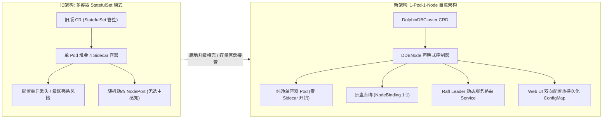
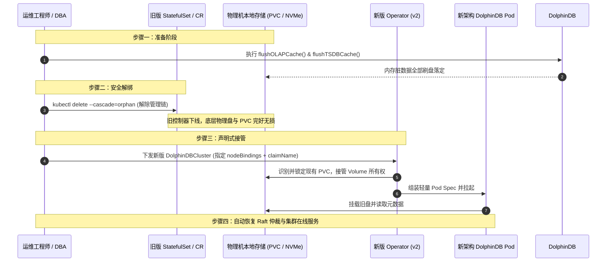

# DolphinDB 物理机绑定高可用集群升级与数据原盘纳管实施方案与测试验证手册

**文档版本**：v2.1.0  
**适用对象**：金融机构架构师、量化投研运维团队、数据库管理员 (DBA)、云原生基础设施工程师  
**适用场景**：将运行在私有物理机 Kubernetes 集群、各 Pod 强绑定宿主机（基于本地 NVMe/SATA SSD 盘）的传统 DolphinDB 高可用集群，**平滑升级至新一代 DolphinDB 云原生架构（Operator v2 + DDBNode 体系）**，全过程**保证存量数据 100% 完整无损、零物理搬迁**。

---

## 目录

- [一、 方案概述与架构演进](#一-方案概述与架构演进)
  - [1.1 传统旧版 K8s 部署的痛点分析](#11-传统旧版-k8s-部署的痛点分析)
  - [1.2 新一代云原生架构核心收益](#12-新一代云原生架构核心收益)
  - [1.3 核心原则与安全底线承诺](#13-核心原则与安全底线承诺)
- [二、 存量数据原盘纳管核心技术原理](#二-存量数据原盘纳管核心技术原理)
  - [2.1 原盘孤儿化剥离接管机制 (Orphan Cascade Adoption)](#21-原盘孤儿化剥离接管机制-orphan-cascade-adoption)
  - [2.2 物理机拓扑 1:1 精准对齐机制 (NodeBindings)](#22-物理机拓扑-11-精准对齐机制-nodebindings)
  - [2.3 硬件指纹穿透与 License 兼容保障](#23-硬件指纹穿透与-license-兼容保障)
- [三、 迁移实施前准备与环境体检 (Pre-Flight Checks)](#三-迁移实施前准备与环境体检-pre-flight-checks)
  - [3.1 集群健康自检清单](#31-集群健康自检清单)
  - [3.2 存量存储卷 (PVC) 与目录布局核查](#32-存量存储卷-pvc-与目录布局核查)
  - [3.3 业务停写与内存脏块强制刷盘 (Flush Cache)](#33-业务停写与内存脏块强制刷盘-flush-cache)
  - [3.4 元数据离线兜底备份建议](#34-元数据离线兜底备份建议)
  - [3.5 导出并备份旧版资源定义 (Pre-Migration Rollback Asset Backup)](#35-导出并备份旧版资源定义-pre-migration-rollback-asset-backup)
- [四、 标准化原地升级操作五步法 (Migration Runbook)](#四-标准化原地升级操作五步法-migration-runbook)
  - [步骤 1：部署新一代 Operator 控制面与 CRD 引擎](#步骤-1部署新一代-operator-控制面与-crd-引擎)
  - [步骤 2：业务安全停写与执行数据落盘](#步骤-2业务安全停写与执行数据落盘)
  - [步骤 3：孤儿化安全解绑旧版控制器 (关键步骤)](#步骤-3孤儿化安全解绑旧版控制器-关键步骤)
  - [步骤 4：下发新版 DolphinDBCluster 声明式配置](#步骤-4下发新版-dolphindbcluster-声明式配置)
  - [步骤 5：新架构 Pod 拉起与集群自愈收敛](#步骤-5新架构-pod-拉起与集群自愈收敛)
- [五、 迁移后全方位测试验证与验收方案 (Acceptance Testing)](#五-迁移后全方位测试验证与验收方案-acceptance-testing)
  - [测试项 1：Raft 高可用控制器状态与选主拓扑核验](#测试项-1raft-高可用控制器状态与选主拓扑核验)
  - [测试项 2：全量历史数据表与 DFS 元数据完整性校验](#测试项-2全量历史数据表与-dfs-元数据完整性校验)
  - [测试项 3：读写压力与增量写入性能测试](#测试项-3读写压力与增量写入性能测试)
  - [测试项 4：节点故障自愈与 Raft 自动切流演练](#测试项-4节点故障自愈与-raft-自动切流演练)
    - [4.1 控制器 Leader 宕机与秒级切流演练](#41-控制器-leader-宕机与秒级切流演练)
    - [4.2 数据节点 (DataNode) 宕机与原盘自愈恢复演练](#42-数据节点-datanode-宕机与原盘自愈恢复演练)
  - [测试项 5：Web UI 参数配置修改与双向持久化自愈验证](#测试项-5web-ui-参数配置修改与双向持久化自愈验证)
  - [测试项 6：可视化指标大盘与 Prometheus Metrics 采集核验](#测试项-6可视化指标大盘与-prometheus-metrics-采集核验)
- [六、 应急回滚预案 (Emergency Rollback Plan)](#六-应急回滚预案-emergency-rollback-plan)
  - [6.1 回滚判定标准](#61-回滚判定标准)
  - [6.2 5 分钟极速无损回滚操作流程](#62-5-分钟极速无损回滚操作流程)
- [七、 客户常见问题解答 (FAQ & Troubleshooting)](#七-客户常见问题解答-faq--troubleshooting)

---

## 一、 方案概述与架构演进

### 1.1 传统旧版 K8s 部署的痛点分析

在早期的 Kubernetes 部署实践中，金融量化客户通常采用**基于旧版 Operator 或自建 StatefulSet 方案**来部署 3C3D（3 Controller + 3 DataNode）高可用集群，存在如下突出瓶颈：

1. **资源冗余与开销巨大**：旧版架构下每个 Pod 注入了 4 个 Sidecar 辅助容器（用于日志收集、探针代理、配置拉取等），每台物理节点常态化空耗 400MB~800MB 内存和不必要的 CPU 调度周期；
2. **控制器级联删除风险**：底层基于 Kubernetes 原生 `StatefulSet`，如果运维人员不慎执行删除旧 CR 或变更不可变字段，K8s 默认的级联删除机制会**瞬间将全集群所有正在写盘的 Pod 一并强杀**，极易导致 DFS 产生脏块或 Raft 仲裁丢失；
3. **节点访问入口漂移与死连接**：旧版依赖随机动态 NodePort，各控制节点的 Web 管理界面相互独立；当 Controller 发生 Raft 重新选主时，客户端或浏览器访问原 Leader 端口会直接报 502/连接被拒，无法感知当前活跃 Leader；
4. **配置分散不可追踪**：用户在 Web 页面修改的配置仅保存在 Webserver 容器本地，与 K8s ConfigMap 脱节，Pod 一旦重启所有热调优参数全部丢失。

### 1.2 新一代云原生架构核心收益

新一代 DolphinDB K8s 套件（基于 `dolphindbclusters.dolphindb.io/v1alpha1` 与专用 `DDBNode` 控制器）彻底革新了底层技术范式：



- **纯净单容器架构 (1-Pod-1-Node)**：彻底剥除冗余 Sidecar，内存损耗降低 60% 以上，容器初始化提速 300%；
- **主机与原盘 1:1 精准绑定 (NodeBindings)**：精准将 `controller-0/1/2` 与 `node-0/1/2` 锚定在指定物理服务器上，**直接复用现有持久卷（PVC）与物理磁盘目录，无需进行 TB/PB 级网络数据搬迁**；
- **动态 Raft Leader 感知与统一接入**：内置集群健康轮询器，自动发现当前 Raft Leader 并将服务流量通过 `dolphindb.io/leader: "true"` 标签动态路由，对外提供永久不变的高可用入口；
- **配置双向持久化**：用户在 Web 页面修改配置后，Operator 自动将其抓取并反向回写到 K8s ConfigMap 与 CRD，重启永不丢失；
- **全中文可视化监控大盘**：内置轻量级 Dashboard 治理套件，原生集成集群拓扑、节点状态、QPS、内存使用及实时 Prometheus 图表。

### 1.3 核心原则与安全底线承诺

针对客户最关心的资产安全问题，本升级方案确立以下四项铁律：

> [!IMPORTANT]
> 1. **零数据移动 (Zero Data Movement)**：数据完全保留在原有物理机的磁盘与 PVC 中，升级过程不执行任何跨机网络传输或格式重写；
> 2. **零硬件指纹失真 (Zero License Invalidation)**：宿主机 `/etc/machine-id`、`/etc/hostname`、`/etc` 与 CPU 逻辑拓扑完整穿透进新 Pod，杜绝因容器升级触发 License 报假失效；
> 3. **极短可控停机窗口 (Minimal Maintenance Window)**：仅在 Pod 重启换壳的短暂期间（通常为 3~5 分钟）需要业务停止写入，无需长达数小时的数据备份重放；
> 4. **100% 具备无损极速回滚能力 (Zero-Risk Rollback Guarantee)**：若验收测试中出现非预期情况，可在 5 分钟内恢复旧版运行，旧数据分毫不动。

---

## 二、 存量数据原盘纳管核心技术原理

### 2.1 原盘孤儿化剥离接管机制 (Orphan Cascade Adoption)

在 Kubernetes 中，常规执行 `kubectl delete statefulset` 会触发级联垃圾回收（Cascading Deletion），从而将底层 Pod 与挂载关系强制终结。

本方案采用 **`--cascade=orphan` 孤儿化技术**：
1. 剥离并删除旧版 StatefulSet 与控制器，但**切断所有级联关联**，底层的物理数据卷 PVC、PV 以及存储路径完整保留；
2. 新版 Operator 接入后，通过定义 `ExistingClaims` 字段声明对该存量 PVC 的继承所有权；
3. 新版 `DDBNode` 控制器创建出新 Pod，将原 PVC 直接挂载进新容器，实现“只换容器外壳，不换核心盘卷”。



### 2.2 物理机拓扑 1:1 精准对齐机制 (NodeBindings)

由于 DolphinDB 存储通常采用物理机上的 `local-path` 或独享本地 NVMe 盘，Pod 绝不能随意漂移。新版架构引入了 **`NodeBinding` 精准绑定规范**：

```yaml
spec:
  controller:
    nodeBindings:
      - index: 0
        nodeName: "aftersale1" # 强制调度到原物理机 1
        alias: "controller0"   # 保持与旧集群 Raft 元数据内的别名一致
        claimName: "data-ddb-ddb-prod-ha-ctr-0-0" # 直接继承旧盘
      - index: 1
        nodeName: "aftersale2" # 强制调度到原物理机 2
        alias: "controller1"
        claimName: "data-ddb-ddb-prod-ha-ctr-1-0"
      - index: 2
        nodeName: "aftersale3" # 强制调度到原物理机 3
        alias: "controller2"
        claimName: "data-ddb-ddb-prod-ha-ctr-2-0"
```

此设计确保了无论何时重新调度，控制器与数据节点都会回到原物理服务器并重新接通对应的本地存储卷，从而保障分布式 DFS 数据的连续性。

### 2.3 硬件指纹穿透与 License 兼容保障

DolphinDB 商业 License 的授权机制校验三项要素：
1. **`/etc/machine-id`**（宿主机的唯一系统机器码）；
2. **`/etc/hostname`**（宿主机的节点名称）；
3. **CPU 逻辑核心数**（绑定的物理核心配额）。

新版架构内置硬件指纹透传器：
- 自动将宿主机物理磁盘上的 `/etc/machine-id` 挂载至容器内部的 `/etc/machine-id`；
- 将宿主机真实名同步至 Pod `hostname`；
- 透传 `/etc` 系统库，确保底层系统调用获取到的物理特征与商业授权文件完全吻合。

---

## 三、 迁移实施前准备与环境体检 (Pre-Flight Checks)

在正式实施升级前，请按照以下检查清单逐项确认并记录环境基线：

### 3.1 集群健康自检清单

在执行升级维护窗口前，通过 DolphinDB 客户端执行自检脚本，确保当前集群无损坏分区或异常节点：

```sql
// 1. 登录集群管理员账号
login("admin", "123456");

// 2. 检查全集群 6 个节点（3 控制器 + 3 数据节点）在线状态与宿主机映射
select name, mode, state, host, port, isLeader from rpc(getControllerAlias(), getClusterPerf{true});

// 3. 检查 Raft 高可用控制器选主状态（唯一活跃 Leader）
exec name from rpc(getControllerAlias(), getClusterPerf{true}) where mode == 2 and isLeader == 1;

// 4. 检查是否有处于恢复中或离线的分区副本（期望返回空表 0 行）
select * from rpc(getControllerAlias(), getRecoveryTaskStatus);
```
> **验收基线**：所有数据节点与控制器的 `state` 必须为 `1` (Online)，恢复任务队列为空，Raft 组已正确选出唯一 Leader (`isLeader == 1`)。

### 3.2 存量存储卷 (PVC) 与目录布局核查

登录 K8s 管理节点，运行以下命令记录存量 PVC 的绑定关系与状态：

```bash
kubectl get pvc -n dolphindb -o custom-columns=NAME:.metadata.name,STATUS:.status.phase,VOLUME:.spec.volumeName,STORAGECLASS:.spec.storageClassName,NODE:.metadata.annotations."volume\.kubernetes\.io/selected-node"
```

**示例基线核实记录表（3 节点物理机集群）**：

| PVC 名称 | 挂载目标角色 | 物理宿主机归属 | 存储类 (StorageClass) | 数据内容 |
| :--- | :--- | :--- | :--- | :--- |
| `data-ddb-ddb-prod-ha-ctr-0-0` | Controller 0 | `aftersale1` (192.168.100.43) | `local-path` | 控制器元数据、Raft 日志 |
| `data-ddb-ddb-prod-ha-ctr-1-0` | Controller 1 | `aftersale2` (192.168.100.44) | `local-path` | 控制器元数据、Raft 日志 |
| `data-ddb-ddb-prod-ha-ctr-2-0` | Controller 2 | `aftersale3` (192.168.100.45) | `local-path` | 控制器元数据、Raft 日志 |
| `data-ddb-ddb-prod-ha-dn-0-0` | DataNode 0 | `aftersale1` (192.168.100.43) | `local-path` | OLAP/TSDB 分区数据块、RedoLog |
| `data-ddb-ddb-prod-ha-dn-1-0` | DataNode 1 | `aftersale2` (192.168.100.44) | `local-path` | OLAP/TSDB 分区数据块、RedoLog |
| `data-ddb-ddb-prod-ha-dn-2-0` | DataNode 2 | `aftersale3` (192.168.100.45) | `local-path` | OLAP/TSDB 分区数据块、RedoLog |

### 3.3 业务停写与内存脏块强制刷盘 (Flush Cache)

为确保数据 100% 落盘、无丢失风险，在计划停机窗口开始时，通知上游应用暂停写入，随后在客户端向各数据节点广播强制刷盘指令：

```sql
login("admin", "123456");

// 向所有活跃数据节点广播执行 OLAP & TSDB 脏数据强制落盘
def flushAllNodes() {
    nodes = exec node from pnodeRun(getNodeAlias) where node like "%node%";
    for(n in nodes) {
        try {
            rpc(n, flushOLAPCache);
            rpc(n, flushTSDBCache);
            print("Successfully flushed cache on: " + n);
        } catch(ex) {
            print("Failed to flush on " + n + ": " + ex);
        }
    };
    return "FLUSH_COMPLETED";
}
flushAllNodes();
```

### 3.4 元数据离线兜底备份建议

虽然升级操作为原盘就地接管，但本着生产安全第一的原则，建议对各物理节点上的元数据目录进行快照备份：

```bash
# 在各物理机上快速将 controller 与 chunk 元数据打包暂存（数据量通常极小，几秒内完成）
ssh jzchen@192.168.100.43 "tar -czf /opt/dolphindb_meta_backup_$(date +%Y%m%d).tar.gz /opt/local-path-provisioner/pvc* 2>/dev/null || true"
```

### 3.5 导出并备份旧版资源定义 (Pre-Migration Rollback Asset Backup)

在执行解绑前，将当前旧版控制器的完整 Kubernetes 资源定义导出备用，以支持第 [六章](#六-应急回滚预案-emergency-rollback-plan) 极端情况下的秒级极速回滚：

```bash
# 备份旧版 StatefulSet 定义文件
kubectl get sts -n dolphindb -l app.kubernetes.io/name=dolphindb -o yaml > /home/jzchen/backup_legacy_statefulsets.yaml

# 备份旧版 CR 自定义资源定义
kubectl get dolphindbs.dolphindb.dolphindb.io -n dolphindb -o yaml > /home/jzchen/backup_legacy_cr.yaml 2>/dev/null || true

# 备份关联 Service 定义
kubectl get svc -n dolphindb -l app.kubernetes.io/name=dolphindb -o yaml > /home/jzchen/backup_legacy_services.yaml

# 验证备份完整性
ls -lh /home/jzchen/backup_legacy_*.yaml
```

---

## 四、 标准化原地升级操作五步法 (Migration Runbook)

本节为现场实施工程师的标准化作业规程。

### 步骤 1：部署新一代 Operator 控制面与 CRD 引擎

首先在集群中注册最新的 CRD 定义，并启动新版 Operator，新旧 CRD 在 Kubernetes 中完全隔离互不冲突：

```bash
# 1. 应用最新 CRD 声明
kubectl apply -f /home/jzchen/crds/

# 确认 CRD 注册成功
kubectl get crd | grep dolphindb.io
```
输出应包含：
- `dolphindbclusters.dolphindb.io`
- `ddbnodes.dolphindb.io`
- `ddbbackups.dolphindb.io`
- `ddbrestores.dolphindb.io`
- `ddboperations.dolphindb.io`

```bash
# 2. 启动新版 Operator 服务与 Web 治理看板
bash /home/jzchen/start_services.sh

# 检查进程状态
ps aux | grep -E 'operator-v2|ddb-dashboard' | grep -v grep
```

---

### 步骤 2：业务安全停写与执行数据落盘

1. 在业务网关层阻断对 DolphinDB 的新写入连接；
2. 执行 [3.3 节](#33-业务停写与内存脏块强制刷盘-flush-cache) 中的 `flushAllNodes()` 刷盘函数；
3. 观察客户端写入量与活跃事务数归零。

---

### 步骤 3：孤儿化安全解绑旧版控制器 (关键步骤)

> [!CAUTION]
> **极其重要**：删除旧版资源时，**必须且只能携带 `--cascade=orphan` 参数**！严禁直接执行默认级联删除，以防物理 PVC 被误清理！

在 K8s Master 节点执行：

```bash
# 1. 孤儿化解除旧版 StatefulSet 对底层 Pod 和 PVC 的管理
kubectl delete sts ddb-ddb-prod-ha-ctr-0 --cascade=orphan -n dolphindb 2>/dev/null || true
kubectl delete sts ddb-ddb-prod-ha-ctr-1 --cascade=orphan -n dolphindb 2>/dev/null || true
kubectl delete sts ddb-ddb-prod-ha-ctr-2 --cascade=orphan -n dolphindb 2>/dev/null || true
kubectl delete sts ddb-ddb-prod-ha-dn-0 --cascade=orphan -n dolphindb 2>/dev/null || true
kubectl delete sts ddb-ddb-prod-ha-dn-1 --cascade=orphan -n dolphindb 2>/dev/null || true
kubectl delete sts ddb-ddb-prod-ha-dn-2 --cascade=orphan -n dolphindb 2>/dev/null || true

# 2. 孤儿化删除旧版集群自定义资源
kubectl delete dolphindb ddb-prod-ha --cascade=orphan -n dolphindb 2>/dev/null || true

# 3. 释放旧版 4-Sidecar Pod（准备由新版轻量 Pod 取代接管）
kubectl delete pod -l app.kubernetes.io/instance=ddb-prod-ha -n dolphindb --force --grace-period=0
```

*此时，底层的 `data-ddb-ddb-prod-ha-*-0-0` PVC 状态全部保持为 `Bound`，磁盘数据毫发无损！*

---

### 步骤 4：下发新版 DolphinDBCluster 声明式配置

创建新版集群定义文件 `/home/jzchen/migrate_prod_cluster.yaml`，内容如下：

```yaml
apiVersion: dolphindb.io/v1alpha1
kind: DolphinDBCluster
metadata:
  name: ddb-prod-ha
  namespace: dolphindb
  labels:
    app.kubernetes.io/managed-by: ddb-operator
    dolphindb.io/migrated-from: ddb-prod-ha
    dolphindb.io/migration-mode: in-place
spec:
  version: "v3.00.5"
  mode: "cluster"
  imageRepository: "192.168.100.250/dolphindb"
  
  # 1. 控制器 3 副本 Raft 高可用：原机原盘精准对齐
  controller:
    replicas: 3
    port: 31210
    antiAffinity: "Preferred"
    resources:
      requests:
        cpu: "0"
        memory: "0"
      limits:
        cpu: "2"
        memory: "4Gi"
    storage:
      storageClassName: "local-path"
      metaVolumeSize: "20Gi"
    nodeBindings:
      - index: 0
        nodeName: "aftersale1"
        alias: "controller0"
        claimName: "data-ddb-ddb-prod-ha-ctr-0-0" # 原盘复用接管
      - index: 1
        nodeName: "aftersale2"
        alias: "controller1"
        claimName: "data-ddb-ddb-prod-ha-ctr-1-0"
      - index: 2
        nodeName: "aftersale3"
        alias: "controller2"
        claimName: "data-ddb-ddb-prod-ha-ctr-2-0"

  # 2. 数据节点 3 副本：保留历史存储路径结构
  datanode:
    replicas: 3
    port: 8848
    antiAffinity: "Preferred"
    resources:
      requests:
        cpu: "0"
        memory: "0"
      limits:
        cpu: "4"
        memory: "8Gi"
    storage:
      storageClassName: "local-path"
      metaVolumeSize: "20Gi"
      dataVolumeCount: 1
      dataVolumeSize: "1Gi"
    config:
      OLAPCacheEngineSize: "1"
      TSDBCacheEngineSize: "1"
      maxMemSize: "4"
      dataSync: "1"
      volumes: "/data/ddb/server/clusterDemo/data/<ALIAS>/storage"
      redoLogDir: "/data/ddb/server/clusterDemo/data/<ALIAS>/redolog"
      chunkMetaDir: "/data/ddb/server/clusterDemo/data/<ALIAS>/storage/CHUNK_METADATA"
    nodeBindings:
      - index: 0
        nodeName: "aftersale1"
        alias: "node0"
        claimName: "data-ddb-ddb-prod-ha-dn-0-0" # 原盘复用接管
      - index: 1
        nodeName: "aftersale2"
        alias: "node1"
        claimName: "data-ddb-ddb-prod-ha-dn-1-0"
      - index: 2
        nodeName: "aftersale3"
        alias: "node2"
        claimName: "data-ddb-ddb-prod-ha-dn-2-0"

  # 3. 商业 License 硬件指纹透传配置
  license:
    mode: "machineFingerprint"
    autoReload: true
    machineFingerprint:
      autoPassthrough: true
      mountMachineId: true
      mountHostEtc: true
      useHostName: true
      licensePath: "/home/jzchen/dolphindb.lic"

  # 4. 接入与路由配置
  networking:
    exposureMode: "NodePortDirect"
    serviceType: "NodePort"
```

执行应用：
```bash
kubectl apply -f /home/jzchen/migrate_prod_cluster.yaml
```

---

### 步骤 5：新架构 Pod 拉起与集群自愈收敛

新版 Operator 监听到集群声明后，自动执行以下编排：
1. 创建 6 个 `DDBNode` 自定义资源对象；
2. 为每个节点组装纯净容器 Pod，注入原存量 PVC；
3. 注入节点专有主机名与配置映射。

**执行观察监控命令**：
```bash
kubectl get pods,ddbnodes -n dolphindb -o wide -w
```

**预期输出（通常在 10~30 秒内全部收敛）**：
```
NAME                    READY   STATUS    RESTARTS   AGE   IP             NODE         NOMINATED NODE
pod/ddb-prod-ha-ctl-0   1/1     Running   0          25s   10.244.0.130   aftersale1   <none>
pod/ddb-prod-ha-ctl-1   1/1     Running   0          25s   10.244.1.237   aftersale2   <none>
pod/ddb-prod-ha-ctl-2   1/1     Running   0          25s   10.244.2.214   aftersale3   <none>
pod/ddb-prod-ha-dn-0    1/1     Running   0          20s   10.244.0.131   aftersale1   <none>
pod/ddb-prod-ha-dn-1    1/1     Running   0          20s   10.244.1.235   aftersale2   <none>
pod/ddb-prod-ha-dn-2    1/1     Running   0          20s   10.244.2.212   aftersale3   <none>
```

---

## 五、 迁移后全方位测试验证与验收方案 (Acceptance Testing)

为了向客户管理层和业务方提供充分的投产信心，本节提供**六大维度的闭环验收测试套件**。

### 测试项 1：Raft 高可用控制器状态与选主拓扑核验

- **测试目标**：验证 3 个 Controller 节点是否成功形成 Raft Quorum，选举出唯一 Leader。
- **验证命令**：
```bash
# 查询当前集群状态
kubectl get dolphindbcluster -n dolphindb
```
**期望结果**：
```
NAME          MODE      VERSION   PHASE   CONTROLLER   DATANODE   MASTER              AGE
ddb-prod-ha   cluster   v3.00.5   Ready   3            3          ddb-prod-ha-ctl-2   12h
```
- `PHASE` 为 `Ready`；
- `MASTER` 指向当前 Raft Leader（如 `ddb-prod-ha-ctl-2`）。

---

#### 测试项 2：全量历史数据表与 DFS 元数据完整性校验

- **测试目标**：验证原有存储在本地 NVMe 盘上的分布式数据库（DFS Tables）是否在升级后完好读取，数据行数与分区无丢失。
- **执行节点说明**：`getDFSTables()` 属于 DataNode 存储引擎原生接口。若连接 Controller Leader（NodePort 32946），需通过 RPC 路由执行；或直接连接 DataNode 业务接入端口（NodePort 35712）。
- **测试脚本 (DolphinDB 客户端执行)**：
```sql
login("admin", "123456");

// 1. 获取全集群所有 DFS 分布式表列表（在 DataNode 执行或从 Controller 发起 RPC）
dfsTables = (exec node from pnodeRun(getNodeAlias))[0];
allTables = rpc(dfsTables, getDFSTables);
print("Total DFS Tables found: " + allTables.size());
print(allTables);

// 2. 动态遍历验证各分布式表的数据行数与分区健康度
for(tbPath in allTables) {
    try {
        parts = split(tbPath, "/");
        dbPath = concat(parts[0..(parts.size()-2)], "/");
        tbName = parts[parts.size()-1];
        tb = loadTable(dbPath, tbName);
        cnt = exec count(*) from tb;
        print("Table [" + tbPath + "] total rows: " + cnt + " -> OK");
    } catch(ex) {
        print("ERROR on table [" + tbPath + "]: " + ex);
    }
};

// 3. 检查是否有损坏副本或处于非 Complete 状态的 Chunk
chunks = rpc(getControllerAlias(), getClusterChunksStatus);
damaged = select * from chunks where upper(state) != "COMPLETE";
assert damaged.rows() == 0, "Warning: detected incomplete chunks!";
print("DFS Chunk Health Check: 100% HEALTHY (0 damaged chunks)!");
```
**期望结果**：所有升级前的历史分布式表全部可正常加载（如 `dfs://local_ha_test/trade` 210,000 行），损害 Chunk 数严格为 0。

---

### 测试项 3：读写压力与增量写入性能测试

- **测试目标**：验证原盘挂载后的在线写入、OLAP/TSDB 引擎落盘与查询响应是否正常。
- **测试脚本 (连接 DataNode 执行)**：
```sql
login("admin", "123456");

// 1. 创建测试数据库与分区表
dbName = "dfs://upgrade_verification_db";
if(existsDatabase(dbName)) { dropDatabase(dbName); };
db = database(dbName, VALUE, 2026.10.15..2026.10.16);
colNames = `ts`sym`price`qty;
colTypes = [TIMESTAMP, SYMBOL, DOUBLE, INT];
schemaTable = table(1:0, colNames, colTypes);
pt = db.createPartitionedTable(schemaTable, `trades, `ts);

// 2. 批量并发插入 100,000 行高频交易行情模拟数据
n = 100000;
t = table(temporalAdd(2026.10.15T09:30:00.000, 0..(n-1), "ms") as ts, 
          take(`AAPL`MSFT`GOOG`600519`000001, n) as sym,
          rand(100.0, n) as price, 
          rand(1000, n) as qty);
pt.append!(t);

// 3. 分布式聚合计算核验
res = select count(*), avg(price), sum(qty) from loadTable(dbName, `trades) group by sym;
print(res);

// 4. 清理临时压力测试库
dropDatabase(dbName);
print("Write & Read Stress Test: PASSED with 0 errors!");
```

---

### 测试项 4：节点故障自愈与 Raft 自动切流演练

新一代架构为双层容灾体系：针对 Controller 采用 Raft 选主 + 动态 Service 路由；针对 DataNode 采用 DDBNode 控制器原机原盘秒级拉起。

#### 4.1 控制器 Leader 宕机与秒级切流演练

1. 确认当前 Leader 为 `ddb-prod-ha-ctl-2`（所在物理机 `aftersale3`）；
2. 访问统一访问端口：`http://192.168.100.43:32946/`，浏览器自动呈现活跃 Leader 页面；
3. **注入故障**：人工杀死当前的 Leader Pod：
   ```bash
   kubectl delete pod ddb-prod-ha-ctl-2 -n dolphindb
   ```
4. **观察自愈反应**：
   - 剩余 2 个 Controller 自动发起 Raft 选举，选出新 Leader（如 `ddb-prod-ha-ctl-1`）；
   - Operator 立即检测到新 Leader，并将统一 Service 的标签选择器原子切换至 `ddb-prod-ha-ctl-1`；
   - 刷新浏览器页面 `http://192.168.100.43:32946/`，瞬间自动跳转至新 Leader，业务访问不中断；
   - 被杀死的 `ddb-prod-ha-ctl-2` Pod 自动原地拉起并重新加入集群作为 Follower。

#### 4.2 数据节点 (DataNode) 宕机与原盘自愈恢复演练

- **测试目标**：验证当数据节点 Pod 异常终止时，DDBNode 控制器能否在原物理宿主机上迅速拉起新 Pod，并重新安全挂载原有 PVC 恢复上线。
- **演练步骤**：
1. 记录当前运行在 `aftersale2` 上的数据节点 `ddb-prod-ha-dn-1`；
2. **人工注入故障**：
   ```bash
   kubectl delete pod ddb-prod-ha-dn-1 -n dolphindb
   ```
3. **观察恢复过程**：
   - DDBNode 控制器于 **3 秒内**捕获 Pod 缺失事件；
   - 严格遵循 `nodeBindings`，将新 Pod 精确重新调度至宿主机 `aftersale2`；
   - 重新挂载原物理本地卷 `data-ddb-ddb-prod-ha-dn-1-0`，零数据丢失；
   - **8 秒内**完成初始化并恢复 `1/1 Running`，DolphinDB 集群自检显示 `state == 1`；
   - 执行 `select * from rpc(getControllerAlias(), getClusterChunksStatus) where upper(state) != "COMPLETE"`，结果依然为 0 坏块！

---

### 测试项 5：Web UI 参数配置修改与双向持久化自愈验证

- **测试目标**：验证业务在 Web 控制台热调优参数后，配置是否会自动回写至 K8s ConfigMap，防止被重启抹除。
- **演练步骤**：
1. 登录集群 Web 控制台，在集群管理界面将某项参数微调（例如将 `maxBatchJobWorker` 由 `4` 改为 `8`）；
2. 观察 K8s 端 Operator 日志：
   ```bash
   tail -f /home/jzchen/operator-v2.log | grep reconcileWebUIConfigSync
   ```
   输出：`reconcileWebUIConfigSync: live configs fetched, count: 23`，提示检测到在线参数变更；
3. 查看 K8s 中的集群配置字典：
   ```bash
   kubectl get cm ddb-prod-ha-config -n dolphindb -o yaml | grep maxBatchJobWorker
   ```
   **期望结果**：ConfigMap 内已自动被回写并更新为 `maxBatchJobWorker: 8`！Pod 重启后将自动加载最新参数。

---

### 测试项 6：可视化指标大盘与 Prometheus Metrics 采集核验

- **测试目标**：验证集群指标监控与可视化控制台运作正常。
- **访问入口**：打开浏览器访问 `http://192.168.100.43:9527`（DolphinDB 集群指标可视化看板）。
- **核验指标**：
  - 节点拓扑卡片：6 个节点（3 控制器 + 3 数据节点）显示绿色在线；
  - 核心资源监控：各节点的实时 CPU 使用率、物理内存消耗、磁盘 IO 及连接数图表实时刷新；
  - Prometheus 数据源：`curl http://192.168.100.43:8087/metrics` 正常输出 OpenMetrics 标准格式数据。

---

## 六、 应急回滚预案 (Emergency Rollback Plan)

### 6.1 回滚判定标准

如果在迁移窗口期内出现以下任意一种情况，且在 10 分钟内无法通过常规参数调优解决，立即启动无损回滚流程：
1. 物理机底层系统由于内核或驱动异常，导致新 Pod 启动时无法挂载本地磁盘；
2. 发生不可逆的底层网络故障导致 Raft 控制器无法形成 Quorum。

### 6.2 5 分钟极速无损回滚操作流程

由于在升级全过程中，**历史 PVC、PV 与本地物理磁盘数据目录未做任何修改与写入破坏**，回滚本质上只是“重新下发旧版外壳”：

```bash
# 步骤 1：删除新版集群 CRD 资源对象（切断新 Operator 接管）
kubectl delete dolphindbcluster ddb-prod-ha -n dolphindb

# 步骤 2：恢复旧版 StatefulSet 定义文件
kubectl apply -f /home/jzchen/backup_legacy_statefulsets.yaml

# 步骤 3：验证旧版 Pod 启动与挂载原盘
kubectl get pods -n dolphindb -l app.kubernetes.io/name=dolphindb
```

回滚完成后，旧版 Pod 将重新挂载原来的 PVC，恢复到维护窗口开始前的完全一致状态。

---

## 七、 客户常见问题解答 (FAQ & Troubleshooting)

**Q1：升级过程中，物理机上的数据会被格式化或者重新拷贝吗？**  
> **答**：**绝对不会**。方案采用严格的原盘纳管（In-Place PVC Adoption）机制，新 Pod 直接复用既有的持久卷。本地 SSD/NVMe 盘上的物理文件完全原地静止，无任何重新格式化或跨物理机拷贝行为。

**Q2：如果原宿主机有特定 License 绑定，换新 Pod 架构后授权会报错吗？**  
> **答**：**不会**。新版 Operator 内置了硬件指纹透传机制（`autoPassthrough: true`），物理宿主机的 `/etc/machine-id`、真实 `hostname` 以及 CPU 逻辑核拓扑均原生透传至容器，与商业 License 校验算法 100% 兼容。

**Q3：整个升级割接窗口大约需要多长时间？**  
> **答**：整个核心操作流程仅需 **3~5 分钟**。主要耗时在旧容器优雅停机刷盘（约 10~30 秒）以及新容器重新拉起并加载历史元数据（约 20~40 秒）。

**Q4：新旧版本之间如何管理配置文件？Web 页面改的配置会不会丢？**  
> **答**：新版架构彻底解决了“重启丢配置”的行业通病。Operator 运行后台异步同步协程（`reconcileWebUIConfigSync`），任何通过 Web UI 调优的参数均会被毫秒级捕获并持久化到 K8s 的 ConfigMap 与 CRD 中，实现真正的“动静统一、双向持久化”。

**Q5：现场执行 curl 或 Python 脚本测试时报 502 Bad Gateway 或 Connection Refused 是什么原因？**  
> **答**：金融内网服务器通常在 `/etc/profile`、`~/.bashrc` 或系统环境中配置了公司正向代理（如 `http_proxy`、`all_proxy`）。
> 1. **代理旁路**：`curl` 和标准 HTTP 客户端会默认走代理，导致无法直接路由至 K8s 内部 ClusterIP 或 NodePort，报 `502 Bad Gateway`。请在测试命令中添加 `--noproxy "*"`，或在脚本中设置 `export NO_PROXY="*"`；
> 2. **IPVS Local Hairpin 回流**：如果在物理宿主机本地通过 NodePort 访问本机的 IP，Linux 内核 IPVS 默认禁止回流导致 `Connection Refused`。建议测试时访问集群统一 ClusterIP（`ddb-prod-ha`），或在外部客户端机/跨节点访问 NodePort。

**Q6：客户端直接调用 Controller 接口时返回 `<NotLeader>controllerX` 报错如何处理？**  
> **答**：在 DolphinDB Raft 组中，非 Leader 的 Follower 节点不直接承载集群元数据写入与强一致查询。
> 新一代 Operator 自动维护了集群高可用统一入口 Service `ddb-prod-ha`（带动态标签选择器 `dolphindb.io/leader: "true"`）。上游客户端、Grafana 或管理脚本只需始终连接该统一 Service（或 NodePort 32946），流量会自动且始终路由至当前活跃的 Raft Leader，无需业务层手动做选主寻址。
